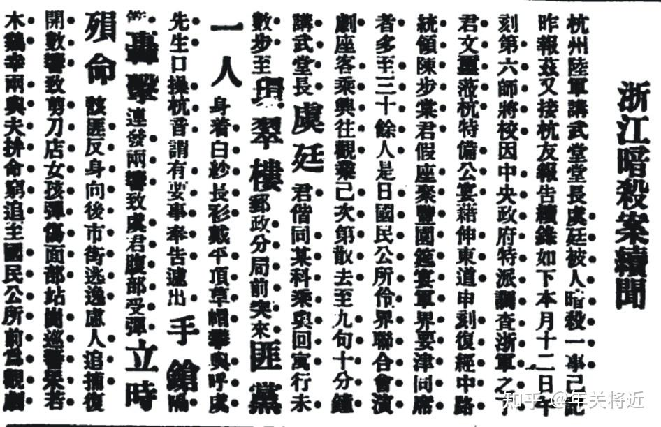
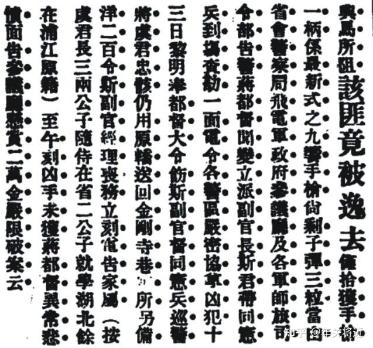

【来源】知乎“年关将近”。https://zhuanlan.zhihu.com/p/349318926
​

据《申报》1912年8月15日报道，浙江讲武堂堂长虞廷被刺，刺客逃逸。

百度搜得：虞廷(1875—1912)，字赓甫，浦江虞宅人。清光绪二十八年(1902)中举。后入浙江武备学堂。毕业后，适金华、衢州、严州、处州四府，在杭州创办公学，被延致主持校政，学校开设测绘专修科。后历任浙江陆军学堂监督、八十二标教练官、温州炮台司令、镇海关守备。1911年11月初杭州光复，率温属各台归正，授都督府顾问官，充第二标统带。江浙联军进军南京，率部前往助战。后被委任为浙江都督府军事参议官、参议厅代理总参议。1912年5月，改任浙江讲武堂堂长，因公事与人龃龉，8月辞职。正拟退隐还乡，行前被刺杀。

刺客何人，没有下文。

又搜得张云雷说法，虞廷被刺案系蒋介石所为。

张云雷说 “蒋志清在陈其美部下 , 就是后来改了名字的蒋介石 , 想讨好他的主子 , 按照陈其美的意图 , 趁 陶成章 在法租 界医 院不备 , 把陶成章枪 杀 了 。浙 江 的人听到这 个恶消 息 , 没 有 一个不悲痛 。 龚未生极 为愤恨 , 多方联 络 有关人 士 , 准 备为陶 成章先 生报仇 。 虞赓甫 听到陈其 美和蒋志 清这 样恶毒 , 气愤 已极 , 常常把他 们的 且事 向大家揭 露 , 联络大 家反对 陈其美 来浙江 当都督 。 陈 其美 、 蒋 志清这 一着适 得其 反 , 弄得 自 己杭 州也不敢走 , 甚至后来在北京开第一届国会 , 陈其美被国 民党 推为参 议员 , 也不敢赴 会 。 为了这件事 , 陈其美 和蒋 志清恨虞 赓甫要 死 。一天虞赓甫坐轿到衙 门办公 , 化了妆的蒋志清就在转弯处等他 , 虞赓甫的轿 子一 出现 , 蒋 志清 介 石 又把虞赓甫杀害 了 。 ”

张云雷，浙 江省乐清县人， 毕业于日本 早稻 田 大学 师范科 。 在 日本 留学期 间 , 先后 加入 同盟会 与光 复会 , 后到 南洋追随 陶成章等 从事革命活动 , 辛亥革 命爆 发后 回国参加杭 州光复 行动 , 杭 州光复 后担任浙 江军政 府参 议 , 后当选为 中华民 国第 一届 国会议 员 , 他应该比较了解 同盟会 与光 复会秘辛, 他的 说法 当有所根据 。

如果这次刺杀真是蒋介石所为，胆子也太大了，真心替未来的蒋中正捏把汗。
发布于 2021-02-04 20:01