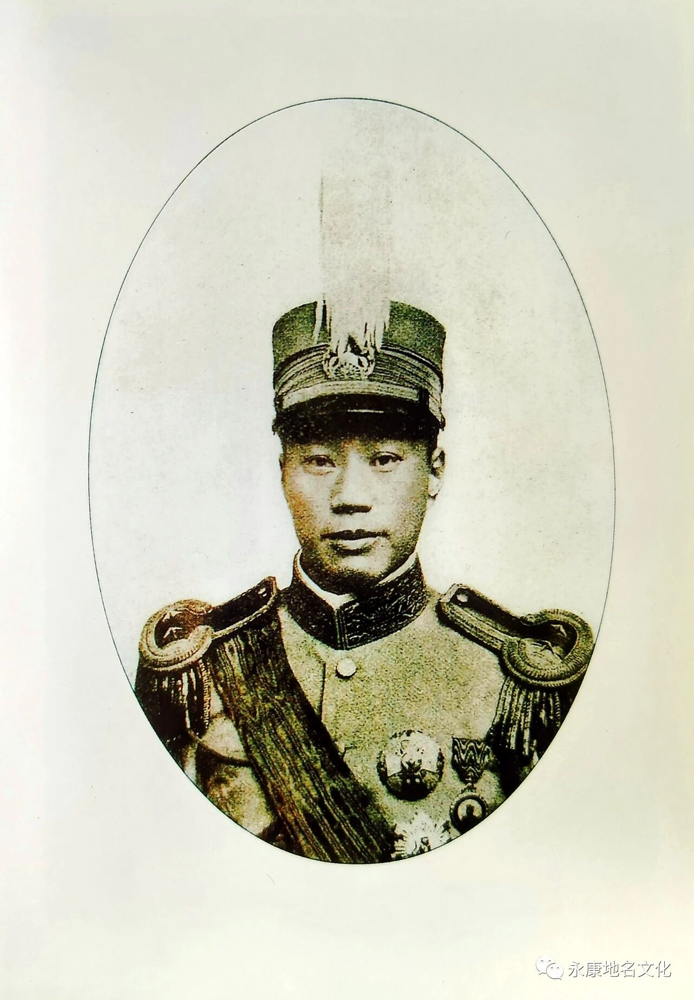
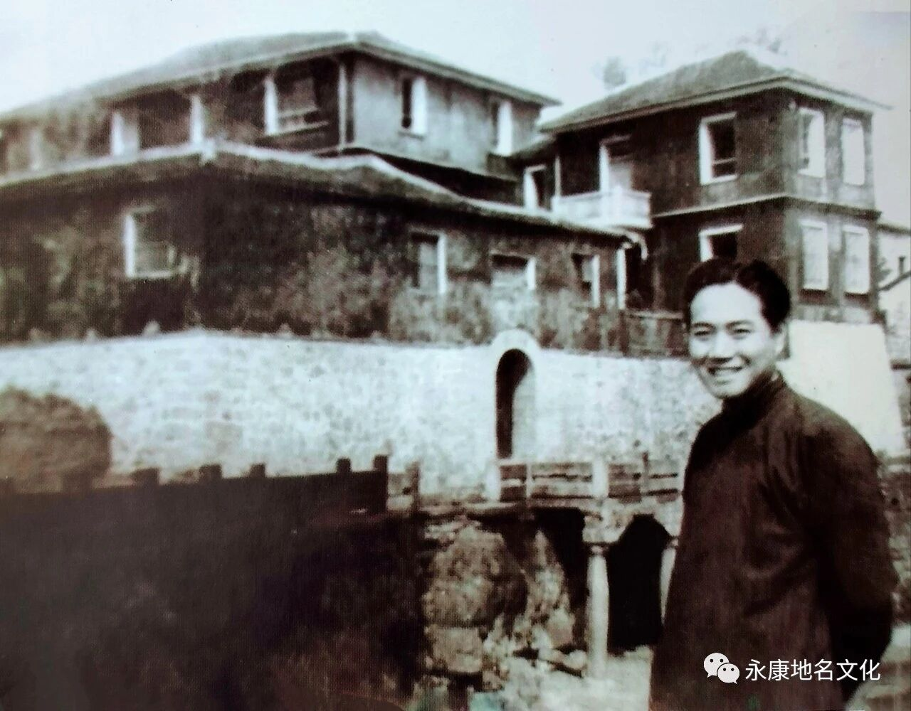
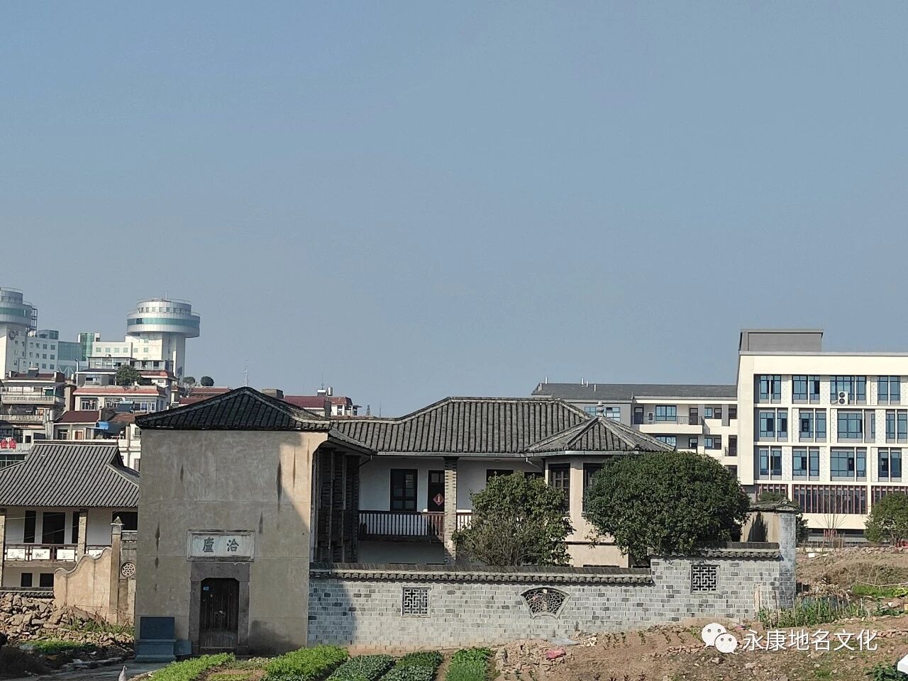
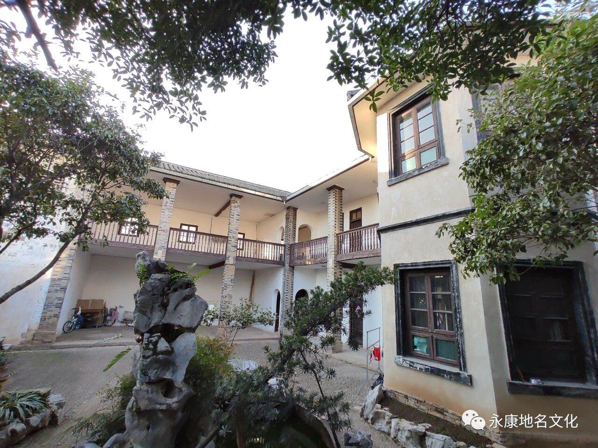
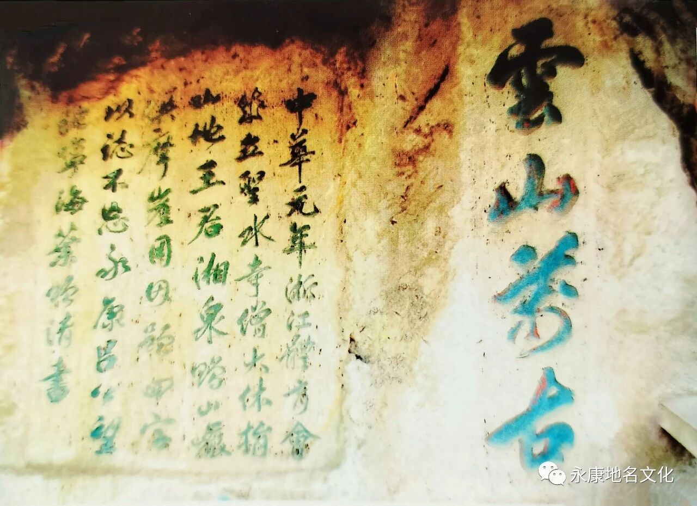
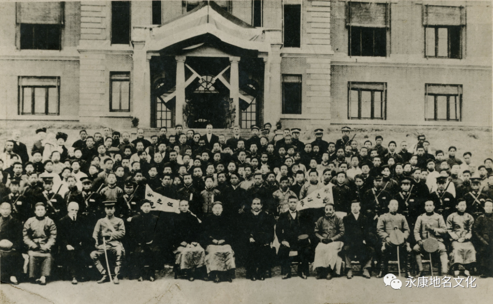

先父吕公望生平事迹

吕凤钗

先父吕公望，原名金银，字叔尚，号“戴之”，又名占鳌。1879年2月28日出生于永康卅里坑横溪马村，自幼天资聪颖；7岁入启蒙馆，后到武义明招寺就读。1898年先父20岁时（清光绪二十四年）戊戌科出考，即中秀才，1900年为廪贡生。后从先祖吕春梧之命，在易川、王洋、下堑等地执教。此期间接受了反满思想书刊的影响，痛感清廷腐败，丧权辱国，萌发爱国主义思想，产生革命要求，遂将廪贡头衔出让给他人，换取130块银洋，作为外出求知的费用[注1]。

1905年2月，先父27岁时到杭州，初进金（华）、衢（州）、严州（建德）、处州（丽水）四府公学求学。受到民主革命思想的影响，不久即退学，另谋出路，经多方求索，后从九龙会（党）永康领导人沈荣卿处知悉徐锡麟、秋瑾的革命活动，急待与之结识。1906年，经缙云人吕逢樵、丁载生介绍，在杭州永康同乡会与秋瑾首次见面，后又多次在西湖的游船上、雷峰塔北面的白云庵小楼上等处讨论国事，商议发展光复会等事宜，成为秋瑾的得力助手。秋瑾拟仿照三合会暗号的方法，使每个同志都有一枚“光字头复字脚”字的小戒指，作为彼此识别的暗号。先父认为这是有形迹的，容易被反动政府看破，不能不审慎从事。于是改刻一个“光字头复字脚”字的小木戳用以证信。 

1906年初，徐锡麟来杭州，寓白云庵。与先父吕公望会晤，谈得很投机。徐对先父是一个廪贡生而肯冒险加入光复会深感钦佩。徐认为革命欲成功，非有军队不可。并因自己要与陈伯平、马光汉、陶焕卿四人拟进日本士官学校受阻未成，而一再鼓励先父从军。徐要去安徽，临别时勉励说：“革命不是一件容易的事。法国革命十年始成，期间不知流过多少热血，以灌溉革命的花实。我这次到安徽去，就是预备流血的。诸位切不可引以为惨，而存退缩之心才好。”先父受到启发，而感其决绝，遂弃廪贡生涯，改名占鳌为“公望”，并决意弃文从戎，以谋革命。经与秋瑾商定，入浙江省巡抚衙门卫队营当兵，以便结纳志士，擒贼擒王。他向抚署递呈了申请，谓：“揆之初度。本自桑弧蓬矢而来；念厥前途，还当马革裹尸而去。”浙省巡抚张曾扬大加赞赏，即将他插入抚署卫队操练。先父利用同乡关系，在卫队中开展革命活动，发展革命势力。　　 

1906年，陆军部保定陆军速成学校招生，浙江选送40名，先父被选在列（蒋介石亦在其中之一）。农历五月十二离杭，十四抵沪。先父介绍学生张鸿翱、童保暄、叶志龙、林兢雄、倪海熏、王萼等，至上海《女学报》社访秋瑾，并均填写了参加光复会的志愿书。抵保定不久，报载徐锡麟刺恩铭被杀。7月，秋瑾被捕，在绍兴就义。报传革命党人名册被抄。闻讯后童保暄等十分紧张。先父比较有思想准备，要求在校（保定军校）的学员沉住气，不到万不得已，决不离开学校，后果平安无事。先父在军校期间，继续联络和发展光复会会员达23人之多。

　　 

1909年，先父于军校炮科毕业后，分发回浙，由督练公所派驻八十二标第二营任见习官。但他念念不忘发展革命力量，而深感江浙革命势孤，欲向别省先求发展。恰值广西筹办新军，需要人手，广西兵备处总办蕴宽、合办纽永建，函招先父前往。1909年底，受军校同学何遂、王勇公之邀，先父私离浙江来广西桂林。同行有日本士官生孔庚、季书城、林知渊、杨曾蔚、覃流金、王勇公、孔孟戟、尹昌衡、杨名远等共三十来人，均是革命党人。先父到达桂林后，蕴宽已离职，由王之祥兼任总办。在新军里，先父任考功科二等科员。为了鼓吹革命，以先父吕公望为经理，严昌衡、覃流金、赵正平为编辑，创办了《指南》月刊，第一期发行2000余份，因“言论过激”被封闭；改出《南风报》，销四千余份，又被封闭；再改名《南报》，也被迫于检查而停刊。桂林巡抚张鸣岐下令，驱逐了一批革命志士，使广西革命计划受挫。先父乃向广西兵备总办蔡锷辞去职务，并与冷遹同行，过香港、九龙，至赵声处，与黄兴、胡汉民相聚后抵沪。1910年回到浙江，在督练公所经理科担任新军预算及统计等项工作。自从徐锡麟、秋瑾等起义失败后，浙江光复会形同解体。一些革命志士认为急需招收新会员，团结老会员。于是先父在紫阳山脚下古太庙巷的住所内作为秘密联络点。当时清廷拟将杨善德的混成协（旅）扩编新军。老会员中有镇海炮台官虞廷，督练公所科员吴德熏，与先父等3人共同策划，先毁杨氏声誉。当即由虞廷起草匿名信，列举杨氏十大罪状，秘密散发，迫使杨善德丢尽面子而去职，扩编新军受挫，并在扩编的新军中有若干中级的军官为革命党人所掌握，为后来浙江的起义取得有利条件。不久先父与朱瑞等见面。朱委托他重整光复会，先父负责对外联系，掌光复会印戳。他的住所成了革命党人的秘密联络点。顾乃斌、韩肇基、庄之盘、朱健哉、虞赓甫、朱瑞和先父等7人为光复会的上一级领导人；先父联系的童保暄、王桂林、孔照道，傅其永等为中级领导人。　　

1911年2月，先父因编造军事预算见赏于抚台增韫，而升任八十标第二二营督队官。但标统（团长）周承韫、营长陈卓等加意压抑，命令他只到营领饷，而不必到营办事出操，怕他在营内“多事”（指发展革命势力），并逼迫先父辞职。5月，先父得知八十标、八十二标的新军已全部争取过来后，适值老同志吴禄贞电促他去北京，乃辞职北上。在北京与吴商定，准备去山东为革命编练一镇（师）新兵。先父南下筹款准备北返时，恰值10月10日武昌起义枪声打响，因虑及吴练兵之事缓不济急而作罢，急赶回杭。参加10月13日、15日先后在白云庵、陶社和火车站二我轩照相馆楼上酒肆召开的光复会干部会议，均无决议。10月19日，在城隍山四景园会议上，先父汇报了与沪接洽的经过后，会议作出决议：1.褚辅成建议起义时举汤寿潜为浙江都督；2.朱瑞建议为减轻起义压力，而促王金发速返绍兴独立，先父赴缙云督吕逢樵密运革命队伍往富阳独立，以便诱城兵外御，以孤其势，易于发难；3.定于11月9日为行动日期，并约先父事先赶回杭州，协助一切，会内事宜及印戳交童保暄代先父负责；4.先父提议由褚辅成往上海李执中处秘运手枪200支，交王桂林。会后先父离杭，赴金华永康、缙云联络。11月4日，革命党人在杭州提前起事。5日，先父在金华接童保暄来电：“杭复，抚擒，署焚，余无恙。”7日先父赶回杭州，参加陶焕卿（成章）[注2]召集的省临时参议会。陶提名应由先父吕公望任浙江参议会议长。鉴于当时革命党人未能驾驭局势的发展，立宪党人和封建官僚乘机混入革命阵营，窃取了要职，童保暄只当了半日都督，其他光复会干部，除王桂林挂个空头宪兵司令外均排斥在外。为此人心不平，加之当时南京未克，江浙难以安枕的形势，先父在会上提出立即出兵进攻南京，以奠定江南，声援武昌，加之当晚又接到第九镇徐绍祯的乞援电报，当即通过并责成先父起草攻宁（南京）计划。未几组成浙军攻宁支队。朱瑞为支队长，先父为参谋长。11月9日，先父带参谋、参军各1人，副官2人，先往沪督陈其美、淞督李执中、苏州程德全处联络攻宁事宜。后来朱瑞率部抵达镇江，与先父同往见徐绍祯、林述庆，谋会师攻宁未果。11月22日，浙军率先进攻南京，经乌龙山之战、幕府山之战、马群之战、天成堡之战，先父亲临前线指挥，连续作战，以少胜多，屡建奇功，以三千兵力，击败张勋的五十营巡防清军。当时正值黎元洪以武昌首义资格，电请各独立省派代表到武昌，筹组临时政府。但当代表到达时，汉阳已为南下的清军攻占，武昌已处于清军炮火威胁之下。11月30日，会议在汉口举行，有11个省代表共23人到会。会议期间形势十分紧急。12月2日，浙江革命军攻占南京，遂稳定了革命形势。后会议转移至南京举行，会议决定南京为中央临时政府所在地，并推举孙中山为临时大总统。1912年1月，宣告了中华民国成立。

1912年，先父辛亥攻宁回浙，任浙军第十一协协统（旅长），后擢升为第六师师长。7月间，原光复会成员朱瑞、叶颂清、沈钧儒与先父等，在杭州举行纪念会，悼念秋瑾殉难五周年。会上决定恢复“体育会”，并在云居山顶立岩碑一方留念。先父题“云山万古”四字，和“民国元年浙江体育会成立，圣水寺僧大休指山地，王君湘泉赠山岩供摩崖用，因题四字，以志不忘。永康吕公望记，宁海叶颂清书。”1982年杭州市人民政府把它公布为市级文保单位，是我国体育史上的重要文物，是我省首先列入文保单位的体育史文物。　　

1912年10月10日，成立浙江体育学校（后改名浙江体育专门学校），先父吕公望任校长，沈钧儒为校董。先父题词“勤静敬奋”四个大字以志校训，同时自编校歌，歌词内容是：“競争世界，武装和平，弱亡强者胜；生死存亡，一发千钧，青年负责任。远追希腊，近师普鲁（德国），铁血铸精神，愿吾同学，勤静敬奋，遵守我校训。”供师生歌唱。　　

1913年，先父吕公望任嘉（兴）湖（州）戒严总司令，驻嘉兴。1914年调任嘉湖镇守使，驻湖州。1915年，袁世凯设立筹安会，预备称帝。孙中山发出《讨袁檄文》。12月，云南宣告独立，蔡锷等组成护国军反袁。1916年，浙江巡按使屈映光想独揽军政大权，将不敢反袁的提督朱瑞赶下台，但屈一时反袁，一时又反对（浙江）独立，舆论哗然。当时袁世凯想利用封官晋爵收买人心，曾亲授朱瑞为公爵，先父吕公望为侯爵，并赐黄马褂等。5月屈映光辞职，公举嘉湖镇守使吕公望继任。先父就职后通电反袁，并任周凤岐、童保暄为师长，列入护国军。檄至粤东，护国军军务院遂依条例请先父就抚军职。于是滇黔粤、两湖及浙江并力讨袁。6月袁世凯气死后，黎元洪继任总统，于7月21日颁正式命令，任命浙江督军吕公望继任省长之职，并按位授勋。
　　

1916年举办了“浙江省中等学校第一次联合运动会”。先父吕公望任会长。浙江体育学校也因校长吕公望新任省长兼督军而威望倍增。省内外许多有志青年纷纷慕名前来报考，体校呈现一片欣欣向荣景象。　　

先父吕公望主持浙江军政，在革命党人的任职上与冯国璋、段祺瑞等分歧。先父想将所兼省长之位让出，又惹起一场风波。冯、段插手，使内讧时起。先父无可奈何，情愿辞职。1917年1月，由段祺瑞主张，黎元洪颁发先父去职的命令，由段系的杨善德接任。在办移交时，杨授意先父把移交的45万银元带走，赠洋房一幢（现工人路总工会）。先父均婉言谢绝，因此当时他在浙江的声望倍增。此事也作为佳话流传至今。　　

段祺瑞一面插手免去先父在浙江的实权，一面召他去北京，授予“怀威将军”衔，在将军府供职，仍由黎元洪颁令。1917年3月，黎元洪、段祺瑞在参加第一次世界大战问题上发生冲突。黎解除段的职务。段离京赴天津，挑动督军团反对黎。6月，黎方被迫招张勋入京，演出了一幕清廷复辟的闹剧。先父坚决反对复辟，而积极参加了段方为反对复辟在马厂“誓师”，组织了“讨逆军”这一活动。张勋败逃后，段祺瑞再度上台。但先父并不受重用，仍在将军府挂名受禄，住天津。　　

段祺瑞把持北洋军阀政府实权后，悍然废弃国会和《临时约法》，实行独裁统治。1917年7月，孙中山号召维持《临时约法》，恢复国会，开展护法运动。8月在粤组织护法军政府，护法战争开始。1918年，童保暄率浙军攻粤，进逼潮（州）汕（头）地区，护法军政府岑春煊知道先父与浙军的老关系，遂派秘书章钊到天津，邀先父赴粤做争取童保暄的工作。5月先父到达潮州，只身带了护兵，赶赴前线，用竹竿高擎着写有“吕公望”三个大字的灯笼，冒死闯进对方阵地，要求童保暄与护法军政府合作。童当面允诺，一面却毁约进攻，但所属陈肇英团随先父反正，童保暄败退。8月29日，护法军政府授予先父为护法军援闽浙军总司令。1919年兼任护法军政府参谋长职。1921年，护法军内部相互排挤，内讧。先父离粤经上海到北京。在北京与冯天祥、何遹等合作，推段祺瑞任临时执政。后因段失信于先父，遂拒绝担任段委任的陆军总长和航空署长等职，离京去天津居住。

1922年，先父与张若曾、金兆桂、熊希龄等在天津筹办女子储蓄银行，先父为董事长，张若曾、胡志仓为常务董事。后因胡志仓贪污舞弊，女子储蓄银行开张仅一年多即倒闭。后又与吕鼎昌、吴天民等集股筹建跑马厅（在上海），亦未告成。　　

1926年北伐战后，先父离津南归，在上海住王桂林家，赶制青天白日旗，准备响应北伐。先父还说服了上海警备司令毕庶澄，投靠北伐军。后因未及与北伐军联系，使毕受袭败退山东，后遭到枪杀。先父为此抱憾终身。　　

1927年1月，北伐军进入浙江后，先父担任江北宣抚使，招抚杂牌军队。后因与何应钦不睦去职，只身带马弁长应桂有，去河南说降靳云鹤，途中历尽艰辛险阻。　　

1928年先父已五十岁。当时国民党政府要他担任监察委员。他对家人说，吾若任此监察委员，定将砍去头颅，因我首先必须弹劾孔（祥熙）朱也。此后先父感到自己仕途不顺，缺乏政治手腕，又不善辞令，决心弃军政而从事商业。他先在上海集资开办永豫纱厂，“一二八”事变后停闭。继又到浙江昌化经营钨矿开采，日军入侵后停办。杭州沦陷后回到老家永康，担任浙江省赈济委员，在永康一带收容大批难民，创办浙江省赈济会难民染织工厂，担任总经理。厂内设有儿童教养团和托儿所等。同时开办金衢严桐油运销公司，用土产桐油换取棉纱，以解难民染织工厂原料不足，由此解决了数万难民的生活问题。他还在永康城内筹款建立警报台和医院（时称卫生院），减轻了因日机轰炸而造成的损失。（1942年）永康沦陷后，难民工厂迁往云和、赤石一带，继续收容人数剧增的难民，并增设了分厂、电厂、炼油厂、酱油厂、农场等，直至抗战胜利。随后先父指示难民工厂的办事人员陈铨庭、杜岩友：“遗返之事要好好办，日后好相见。”并吩咐将机器等财产都卖出去，集资作为难民遗返家园的川资。

抗战胜利后，国民党政府伪装民主，为了笼络民心，拉拢一批地方人士来装潢门面，从1946年起，先父担任了浙江参议会副议长。1949年解放前夕，当时杭州的一些进步人士，为了保护全市人民的安全和生活，积极筹组杭州市临时保安协会。4月24日，一致派先父及李培恩、斯烈、张衡、程心锦五人为代表，向当时的省主席周岩交涉，提出有关筹组临时保安协会及四点要求：1.充实粮食库存，保存非常时期的粮食供应；2.保证市面现钞充裕，以安定人心；3.杭州中央银行以往的金银不得外运，交还给地方；4.现存的所有警察不得撤离杭城，留市维持秩序。4月27日，市参议会特邀各界人士商议，组织“杭州市应变委员会”，先父及竺可祯等九人选为常委，负责①维护社会治安；②筹集资金；③救济市民；④保护文化古迹及水、电、交通等设施。4月28日，在应变委员会分组委员会的会议上，先父及金润泉、竺可祯等提议组织“杭州市临时救济委员会”。29日该会成立，先父被选为主任委员。他组织军官总队，加上工人纠察队，救火会火警和民众自卫队，联合维持杭城的社会秩序，使全市秩序大有好转，市面也开始复苏。对此，先父不顾高龄力弱，到处奔波，终使杭市人民日常生活所需的交通、邮电、水、电畅通；使杭州市重要设施钱塘江大桥、西子湖畔名胜古迹均完好无损地回到人民手中，为杭州市立下一功。其本人当时被列入“接赴台湾”之列，省主席周嵒亲自上门来做他的工作，并送来飞机票，要接他一家赴台。先父因不愿再为国民党政府办事，而找老朋友周嵒的父亲帮忙，装病住进医院。　　

杭州一解放，党中央和毛主席就委托谭震林同志亲临先父寓所看望，致谢，并邀请先父出来工作。先父则欣然接受邀请，先后担任了杭州劳军委员会和公债推销委员会委员，中国人民救济总会杭州分会副主席和省政协委员、省人民代表等职。

先父生平爱好书画，喜书钟鼎文；三十年代曾在永康寓所（慎旃堂）开办过图书馆，资助过诗书画社等，对永康的文化事业的发展有过贡献。1954年7月22日晨3时许，先父因患肺扩张症复发，医治无效，在杭州寓所病逝，终年76岁。

[^注1]:吕公望赴杭求学，资助者尚有徐锄榛，字素心，三十里坑人，寄居县城西街，为先儒徐锡禧之胞弟，杭州优级师范堂（今浙师大）毕业，历任金华浙江省立金华府中学堂堂长，绍兴浙江省立第五中学校长，永康县电灯公司董事长等职，在五中校长任内办理完善，教导严格有方，有声于时。徐后来成了吕公望的连襟。他劝说春梧公出资50块白洋，他自己也出了50块，加上出让廪贡生头衔的130块大洋，共230元，吕在望春门坐船奔杭州，一个星期后抵达杭州江干码头。
[注2]:陶焕卿，即陶成章（1878—1912）近代民主革命先驱者，浙江绍兴人。光绪二十八年（1903）留学日本，参加国民革命活动，不久返国，在浙东各地联络会党。1904年与蔡元培等在上海组织光复会。次年与徐锡麟、秋瑾在绍兴办起大通学堂，召集会党，培训骨干。1906年在日本参加同盟会，后赴南洋活动。1910年在东京恢复光复会，推章炳麟为会长，自任副会长。1911年回上海，组织锐进学社，准备起义。武昌起义后，他发动上海、浙江、镇江各地光复军起义。次年1月被陈其美（英士）派蒋介石设计暗杀于上海。

（本文写于1984年下半年，由项瑞英老师推荐发表，并注释，撰作者简介——编者）

照片除署名外均引自《吕公望传》一书

作者简介:

吕凤钗（1912—1985），吕公望次女，系上海大厦教育学院师范专科毕业，嫁永康县城名仕绅杜竹轩长子杜岩友。现存虹霓巷虹霓太祖庙北的洽庐便是吕公望给她的嫁妆。洽庐由吕公望亲自设计，别具西洋意大利风格，是民国县城名宅之一。吕公望有时也来此小住，但非其住宅。吕公望的住宅在梁风桥巷（健康巷）中段，王修吉公祠西，乌伤巷口名慎旃堂，后为人民医院住院部。杜岩友抗战后曾在永中任总务主任之职，有子一杜志刚，女五杜鹃、杜茹茵、杜若萍、杜宜南、杜宜棣。