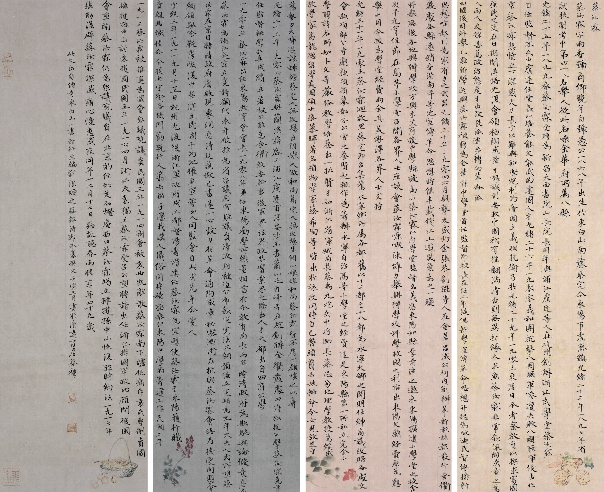

【来源】微信公众号“文化北苑”，https://mp.weixin.qq.com/s/CebYNJdfHfA2EcJg8KmSxA

蔡礼礼

1969年生于浙江东阳，中国书法家协会女书家委员会委员、浙江省书法家协会楷书委员会副主任、浙江省女书法家协会副主席、金华市女书法家协会主席等。主要艺术成果
隶书作品入展第三届全浙展小楷作品获浙江省第五届中青展银奖作品获浙江省第七届全浙展铜奖作品获全国首届手卷展优秀奖（最高奖）作品获“邓石如奖”全国书法大赛优秀提名奖作品获“万山红遍”浙江书法大赛优秀奖（最高奖）小楷作品获十届国展优秀奖（最高奖）作品入展第三届全国中青展作品获浙江省第六届中青展“陆维钊奖”（唯一最高奖）作品入展全国第四届兰亭奖获首届金华市“黄宾虹奖”（最高奖）作品入展全国第二届“翁同和奖”作品入展浙江省第四届兰亭雅集双年展

蔡汝霖
蔡汝霖字雨香彌商卿晓年自蹄愚公一八六八年出生東白山南慧蔡宅今東陽市虎厯鎮光緒二十三年一九七年省
試秋閨考中第四十八名舉人径此名咏金華府所属八縣
光緒二十五年一八九九春蔡汝霖受聘為新昌天西書院山長院長同年與浦江虞廷等人在杭州創辦浙江武學堂蔡法霖
自任監督不么由虞迁任堂長以培養能文能武的建國人才光緒二十六年一九零零義和國抗擊八國腰軍慘遭失敗八國厥軍侵占北
京蔡汝霖悲愤之下深感大刀長子次難與行堅炮利的帝國主義相抗衡乃於光緒二十九年一九零三東度日本考察教有以得求富圖
強民之策在日期間得晤光復會領袖陶成章才認識到要教中國祇有推翻滿清否則無異於緣木求魚蔡汝霖非常欽佩陶成章之為
人雨人友誼甚萬政治態度未由改良派逐步轉向革命派
田國後因科舉已廢新學选興蔡汝霖被聘為金華府中學堂首任監督即校長在任二年提倡新學宣傅草命思想并認為故迪民智傳播新
思想唯報刊為家有力之武器光緒三十年一九零四六月與摯友盛灼金張恭劉琨等人在金華吕成公祠内創耕苹新報＃都裁行金衢
徽慶各縣逺銷香港南洋等地宣傳苹命思想時僅丰載錢江上遊風氣為之一變
科舉廢後各地興辦學校方興未父府設中學縣設高小蔡汝霖以府學堂監督名義應東防知縣李前泮之邀来東陽獷建小學堂之校含
次年元宵住節在高等小學堂各開各界人士座談會蔡汝寡嫌慨陳僻の舉興辦學校科學救固之利指出東陽父廟経原為應
舉之用今拔為學堂經费雨全其美博得各界人士丈持
光緒三十一年一九零五蔡汝霖迴故里蔡宅即各集舊永寧鄉所属各都舊以十三都至十八都為永寧大鄉之開明仕紳高議收歸各度文
會款項部分寺廟款項损暮部公公常之養賢祀祖作為籌辦永寧自治高等小學堂之經賈這是東陽縣第一所私立完金十
學聘請名師如ト父茅嚴格教學培養出一批賢才如淅江省軍械局長蔡禹九屹兵中将師長蔡忠笏地理學教授葛綏成
教學家萬龍德留學美國顧士蔡慕暉著名植物學家蔡希陶等“皆出於詠校同時自己帯頭翦去縣辦命令女兒放兰守
舊摯の大嘩造謡誹謗蔡宅人無玫場出個舉人做和尚葛宅人無改塲生個小娘嫁和尚蔡汝霖皆不屑一願嗤之以鼻
光緒二十三年一九零六蔡汝霖與蘭溪論賡三浦江虞厝雨淳安陸玉書蕭山毛自峰等在杭創辦金衢簾處四府旅杭公學蔡汝霖為首
任監督辦嚳於兵成績卓若被公推為金衢教委斡事後軍界法界政思實業界之得出人才大都出自四府公學
一九零七年蔡汝霖出任東陽教有會會長一九零八年兼任東陽勸豐所總董相當扵今教有局長雨年時清政府為欺騎與論假意立究
蔡汝霖為浙江赴京立究請顧代表并被推為省皆議局常財議貟清政府被迫公布欽空究法大網預偏立完瑚為九年大共人民所望蔡
汝霖在京目時清政府腐败现象洞悉清廷氣數已盡遂一心致力扵革命適陶成章秘家迴浙在抗與蔡法霖會語乃接受同盟會
網頌驅除鞋膚恢復中華建立民國平均地權並宣誓如入同盟會自此成為革命黨人
宣統三年一九二九月十五日杭州光復後漸江軍故府成三都督陽壽潜委任蔡汝霖為宣慰使蔡汝霖全東陽履行職
責親站城楼命合獲乐守街各城門勸說行人翦去辨子還我漢人儀俗同時積極叅加東陽中學的篱建工作民國二年
一九一三蔡汝霖被推選為國會衆議院議負民國三年一九一四国會被袁世凯解散蔡汝霖南下嘯杭痛斥袁氏專制賣國
擁獲孫中山討袁獲國氏國五年一九一六四月浙江及袁獨立蔡汝霖受吕公望聘請出任浙江獲圖軍政治頂問後國
會重聞蔡汝霖仍為泉議院議負在北京的住加為石燈庵西口蔡汝霖竭立神獲孫中山恢没臨時約法一九一七年
張劬復辟蔡汝霖深感痛心優患成疾同年十二月十七日病故驱春雨樓享年四十九歲
此文出自傳奇東白山一書執行主编劉浪赠之蔡錦淸部承豪据父壬宙青書於清遠書座蔡穆

