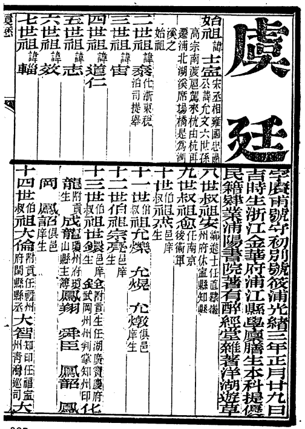
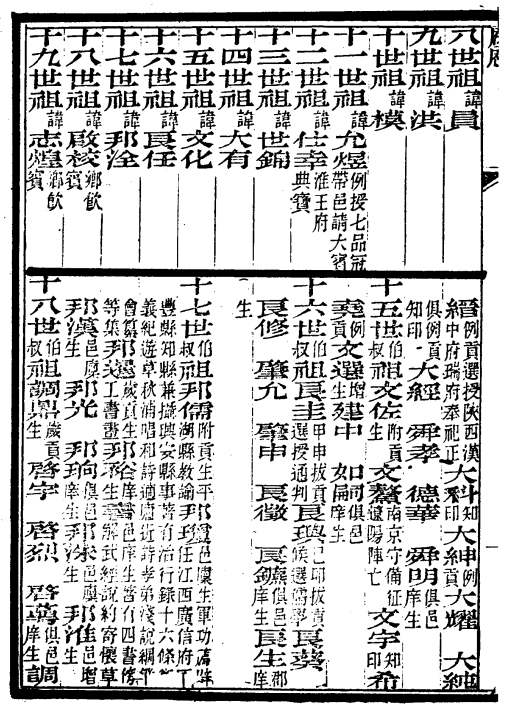
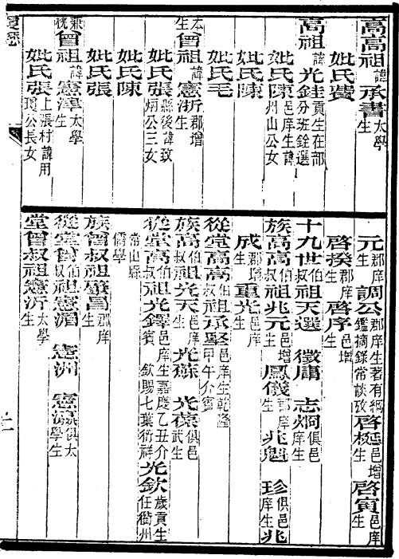
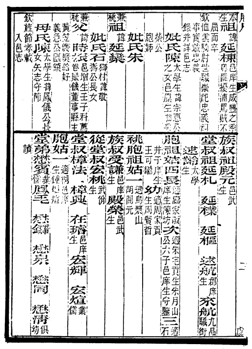
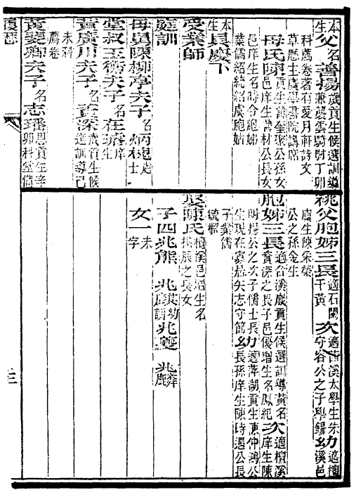
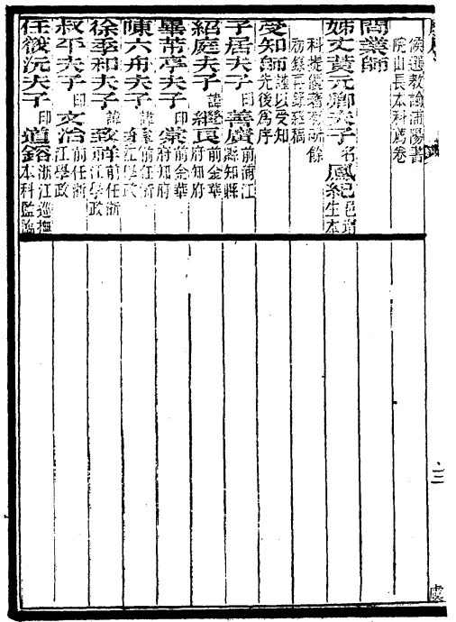
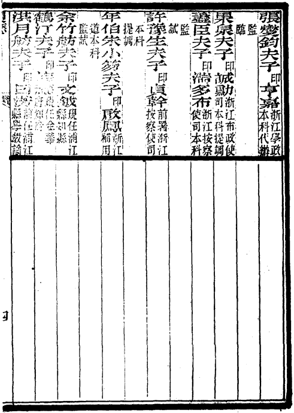
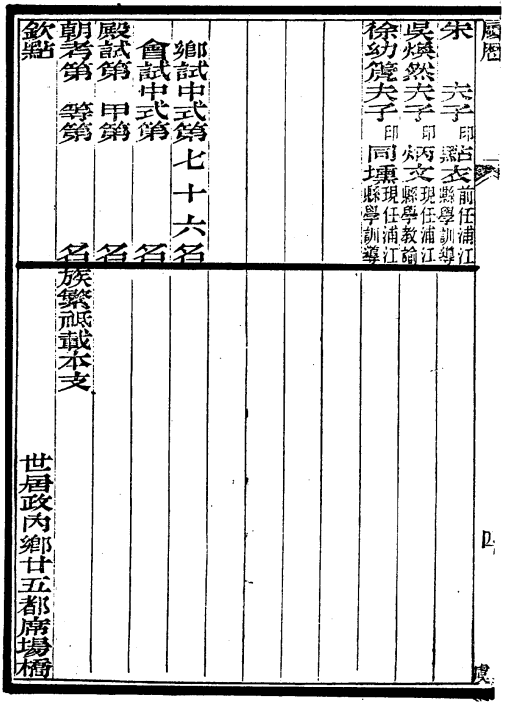

【来源】微信公众号“虞氏人文”2022-5-23

虞廷（1875～1912），字赓甫，浙江省金华市浦江县虞宅二十五都席场桥人。其父善扬为通化广学书院讲席。十八岁补学官子弟（秀才），二十八岁中乡试第七十六名举人。目睹列强侵华，认为非强军不足以御侮卫国。
1903年，虞廷以文举人身份加入浙江武备学堂。在学校里思想进步，与志同道合者纵论形势，讨论国是，彼此之间意气相投。光复会一成立，虞廷即经人介绍于第二年秘密加入。从武备学堂毕业后，他被委派为两浙督练公所调查员。此后，虞廷相继担任浙江陆军学堂监督、浙江陆军八十二标教练官等职，因营救秋瑾引起清政府怀疑，被调往温州任各炮台司令。武昌起义爆发后，东南各省纷纷响应，浙江宣布独立。虞廷欣喜异常，随即率温州各炮台官兵专门致电浙江都督汤寿潜表明立场以示拥护，被委以都督府军事顾问官，不久充任浙江陆军第二标统带官。这一年冬天，东南联军攻打南京，浙军一马当先，与清兵激战，未能攻克。虞廷主动请缨，把自己统领的第二标填补第一标缺额，自任兵站总监。南京之役后，虞廷先被任命为都督府军事参议官、代理参议厅总参议等职，不久又被任命为浙江陆军讲武堂堂长。虞廷目睹辛亥革命后的残酷现实，由困惑惆怅再至失望，决定急流勇退解甲归田告别纷争。
1912年8月12日晚8时半左右，杭州城南大井巷内，虞廷突遇枪杀，当场死亡，年仅三十八岁。

